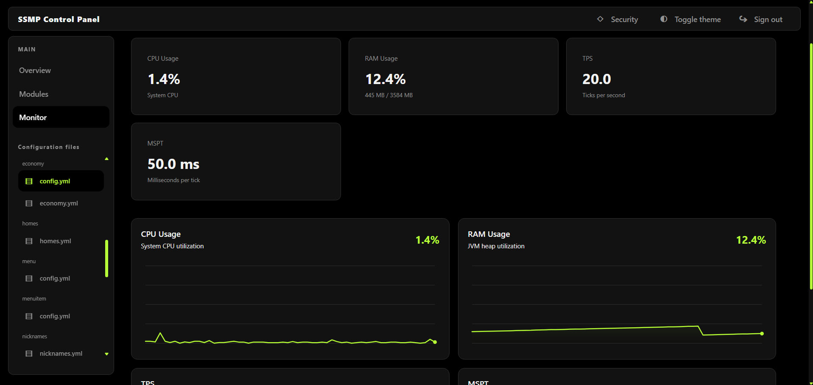

 

  

  

      

  
  

 
<h2>Handles everything, in one simple jar.</h2>

Welcome to Siddy's Simple Plugin, a simplistic plugin that just does the job right! Whilst adding tons of features, like scoreboards, tablist and menus, this plugin adds more and more features, because the list doesn't end! Built completely on Bukkit API, this plugin improves the overall aspect of your server, adding newer features, and stuff you see on those big servers.

To actually show how this server is unique, count how many <b>paper plugins</b> you would require to set up the a big SMP. Probably, 10-20, or even 30, at a minimum. Well, this server bundles features from various mods and plugins into 1 singular jar, and <b>does not steal any code or asset from it</b>.

 

<h2>Wonders of RPG : The central dashboard</h2>
Turn the server that wasn't even supposed to be controlled by a dashboard into one you can access from anywhere. Configure the plugin, use the console and monitor the statistics. This dashboard package will also include a client package, and soon a Passive FTP service willalso be embedded into this (PASV).  
    

  

- Ranks and permissions 
- Chat Formatting and Custom Placeholders
- Warps and Homes
- Main menu + Compass Menu Item
- Tablist and Scoreboard
- Economy with Shop and Auction House
- Kits
- Random Teleport
- Optimizations 
- Modular design
- Contracts
- Bounties
- Levels system
- **NEW** Central Control Dashboard
- **NEW** Update Checker
- **NEW** Auto-Bug solving
- **NEW** Documentation Available !

  

 
<h2>Thank you very much for visiting</h2>
:)
